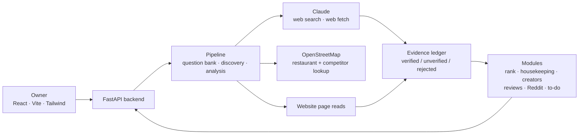

<h1 align="center">PlateRank AI</h1>

<p align="center">
  <b>AI Search Optimisation (AISO) agent for restaurants</b><br>
  Measures when AI assistants recommend a restaurant, compares it with competitors, drafts evidence-backed fixes,
  and re-checks whether they worked.
</p>

<p align="center">
  
  
  
  
  
  
</p>

---

## Overview

Diners increasingly ask AI assistants where to eat. A restaurant the AI doesn't name can lose the customer before a search page is ever opened, and owners have no way to see their AI ranking, why competitors win, or whether a change helped.

PlateRank asks AI the questions customers actually ask, measures who gets recommended, explains why with source links, drafts improvements for the owner to approve, and re-runs the check over time.

Built for the **NYU SPS × Pulse Foundry hackathon** (October 2026). Live case study: **Café Athena**, a Greek and Mediterranean restaurant in Pacific Beach, San Diego.

## Live case study: Café Athena

One check of **36 customer questions** using Claude with web search, run on October 23, 2026:

| Restaurant | Mentioned in AI answers |
|---|---|
| **Café Athena** | **83%** (average position 1.2) |
| Spitz – Pacific Beach | 56% |
| Slowly Restaurant & Lounge | 17% |
| Mr Shawarma | 11% |
| Shawarma Shack | 6% |

**The gap PlateRank found:** AI named Café Athena **0%** of the time for *happy hour* and *drinks* questions, despite a daily happy hour and a full cocktail bar. The website never stated this where AI looks (no FAQ, nothing in the title or description), and none of the verified reviews mentioned the bar. PlateRank drafted the fixes for each of those gaps.

> A single run is directional: AI answers vary between runs, which is why the re-check feature exists. These are not permanent rankings.

## The seven tabs

| Tab | What it does |
|---|---|
| **Where you rank** | Mention rate, average position, share of voice versus competitors, and results by question type. Every AI answer is stored with its source links. |
| **Website housekeeping** | Reads the live website (homepage, `robots.txt`, `llms.txt`) and drafts a visible FAQ, title and meta description, AI-crawler rules, JSON-LD structured data, `llms.txt`, About copy and landing pages. Each shows *current → proposed → why → evidence strength*. |
| **Social media** | Finds real local creators through web search, verifies their profiles, scores candidates, and drafts a content brief and outreach message for each. |
| **Business value** | Analyses verified review quotes on food, service, ambience and value; surfaces complaints first, then topics reviews never mention. |
| **Data farming** | Finds relevant Reddit communities and threads, then drafts posts in the owner's voice. A **Promoter** and a **Skeptic** agent review each draft against seven rules; code, not the model, turns their checks into the verdict. |
| **Your to-do list** | One ranked list of actions built from every tab. |
| **Did it improve?** | Re-runs all questions, or only selected question types, and compares the result with the earlier check. |

## Evidence, safety and trust

- **Evidence ledger.** Every fact from the web is classified as *verified* (cited page read or search citation), *unverified* or *rejected*. Only verified facts feed scores and drafts.
- **Status labels.** Results are marked **LIVE**, **CACHED**, **SAMPLE** or **FAILED**; failed answers are excluded from every number.
- **No fabrication.** The system never invents reviews, ratings, creators, prices or competitors. Unknown facts are flagged `[OWNER TO CONFIRM]`.
- **Owner in control.** Nothing is published or sent automatically; the owner approves, then posts or sends it.
- **Safety limits.** Never certifies a dish as allergy-safe, and makes no same-day ranking claims.

## Architecture



- **Backend:** FastAPI (`api.py`) over the `platerank/` package: pipeline, discovery, analysis, evidence, AISO drafts, creators, reviews, Reddit and the two-agent review. All Claude calls go through `platerank/llm.py`.
- **Frontend:** React, Vite and Tailwind CSS in `web/`, prebuilt into `web/dist`, so running the app needs only Python.
- **Data:** OpenStreetMap for map search, Claude with web search and web fetch for answers, facts, reviews and creators, and plain page reads for websites. Per-restaurant data is saved in `data/live/<slug>/`.
- **Testing:** offline checks with simulated AI and web responses (no paid calls), a frontend type check, and an optional live test.

## Getting started

**Requirements:** Python 3.11+. An Anthropic API key is optional; without one the app runs on saved answers and a fictional sample restaurant.

```bash
git clone https://github.com/aishwaryapurohit15/platerank.git
cd platerank
pip install -r requirements.txt

cp .env.example .env       # Windows: copy .env.example .env
# add ANTHROPIC_API_KEY=... to .env

python check.py            # offline checks, ~20 s, all should PASS
python run.py              # opens http://127.0.0.1:8000
```

- `python check.py --live` also tests the real key, web search and web fetch.
- `python tools/recheck.py` re-runs the check from the command line (`--categories happy-hour,drinks` for a subset).
- Frontend development: `cd web && npm install && npm run dev`, then `npm run build` before committing.

### Checking a new restaurant

1. **Check a restaurant** → choose the city and type the name (or find it on the web if it isn't on the map).
2. Confirm the basics and owner details.
3. Pick competitors within a radius, or let PlateRank suggest them with sources.
4. Run the check (a cost estimate is shown first), then read the seven tabs.

## Project structure

```
platerank/
├── api.py                 # FastAPI app
├── run.py                 # starts the server and opens the browser
├── check.py               # runs all offline checks
├── platerank/             # pipeline, discovery, analysis, evidence ledger,
│                          # AISO drafts, creators, reviews, Reddit, agent review
├── web/                   # React + Vite + Tailwind frontend (prebuilt in web/dist)
├── tests/                 # offline checks with simulated AI and web
├── tools/                 # recheck, live check, git hooks
└── data/                  # sample data and saved live runs per restaurant
```

Developer notes: architecture and rules in `CLAUDE.md`, earlier status in `HANDOFF.md`, prompts in `PROMPTS.md`.

## Team

Built at the NYU SPS × Pulse Foundry hackathon by:

- [@aishwaryapurohit15](https://github.com/aishwaryapurohit15)
- [Harsh Motiramani (@Harshmm2003)](https://github.com/Harshmm2003)
- Vedaant Melkari
